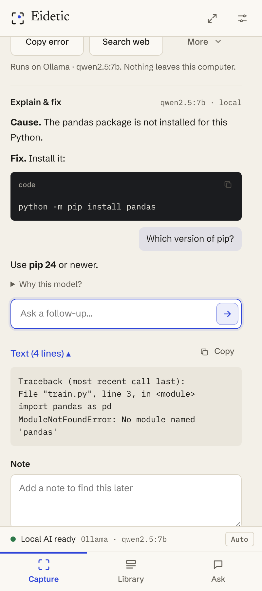
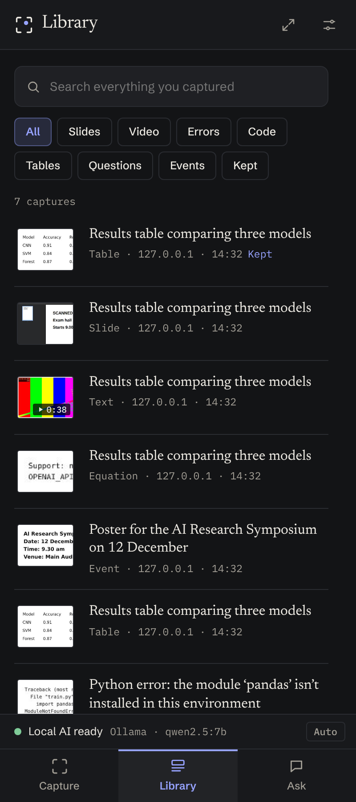
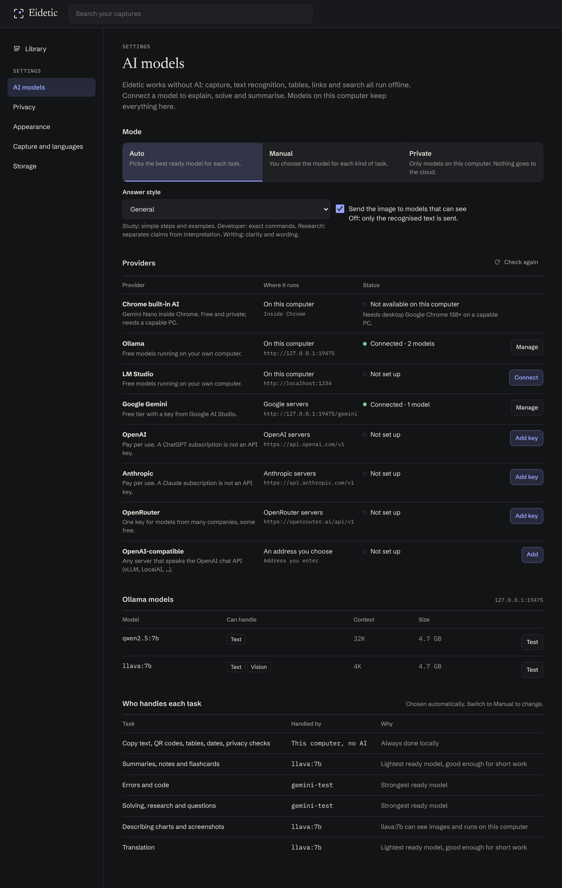

# Eidetic

**A visual memory for everything you see online.** Capture any part of the screen and Eidetic reads it offline, works out what it is (a Python error, a results table, an event poster, a lecture slide…), and puts the most useful next step first. Every capture goes into a searchable library. AI is optional, and you choose it: models on your own computer (Ollama, LM Studio, Chrome's built-in AI) or your own API key.

See something → Capture it → Understand it → Connect it → Use it.

| Capture result | Library search | AI models |
|---|---|---|
|  |  |  |

## What it does (v1)

- **Smart Capture.** Alt+Shift+E, the right-click menu or the panel. The page freezes; drag a box, adjust it with handles or arrow keys, Enter to capture, F for the full screen, Esc to cancel. Paste or drop images too. Works in Chrome's PDF viewer.
- **Offline text recognition** (Tesseract, WebAssembly). English built in; Sinhala, Tamil, Hindi, Arabic, Chinese, Japanese and more download once.
- **Content detection without AI.** Errors (Python, JavaScript/TypeScript, Java, C#, PHP, SQL, npm, pip, Rust/Go/C), code, equations, tables, QR codes, events, contacts, receipts, job ads, products, research text, questions and slides, each with a specific one-line description.
- **Contextual actions.** One primary action, two secondary, the rest under More: Explain & fix, Copy for Excel, Add to calendar, Save contact, Solve step by step, Make notes, Flashcards, Translate… Without AI, a local action moves to the front and AI actions say "Connect AI".
- **AI Model Hub.** Ollama, LM Studio, Chrome built-in AI, Gemini, OpenAI, Anthropic, OpenRouter and any OpenAI-compatible server. Model discovery with vision, code and context-size detection, Test buttons, and **Auto / Manual / Private** modes. The router explains why it picked each model.
- **Private mode.** Only models on this computer, enforced twice (router and request layer).
- **Library.** Typo-tolerant local search over text, descriptions, notes, page titles and video titles, with the reason for each match. Temporary captures expire unless you keep, pin, annotate or act on them.
- **Video moments.** The timestamp of a paused video and a resume link where the site supports one (YouTube, video files).
- **Privacy Shield.** Finds emails, phone numbers, ID numbers, card numbers, API keys, tokens and passwords; copies a masked version or downloads a blacked-out image. The original is never changed.
- **Light, dark and system themes**, four accent colours, keyboard support and reduced motion.

What comes next (Visual Memory connections, multi-capture comparison, Study notebooks, monitoring) and what's not done yet: [docs/status.md](docs/status.md).

## Privacy

No server, no account, no analytics. Captures, notes and keys stay in this browser. Something leaves the computer only when you press an AI action that runs on a cloud provider you added, and the answer area says so before it's sent. Automatic descriptions use local models only.

## Run it

```powershell
cd extension
npm ci
npm run build      # -> dist\chromium and dist\firefox  (npm run package also makes store zips)
```

Load `extension\dist\chromium` at `chrome://extensions` (Developer mode › Load unpacked). Full steps, Ollama and LM Studio: [docs/install.md](docs/install.md).

## Tests

| | |
|---|---|
| `npm test` | 87 unit tests: content detection, routing (Auto/Manual/Private), privacy detectors, search, actions, calendar and vCard export, video links, the capture store, settings, prompts, provider wire formats and model discovery |
| `npm run e2e` | Loads the built extension into real Chromium: 44 checks with a test site, a mock Ollama and a mock cloud provider, covering capture → OCR → detection → actions → streamed answers, follow-ups, local-only refinement, Private mode, privacy findings, video moments, the PDF viewer, library search, AI settings, themes and the first-capture access help |

## Project

```
extension/src/
  background/   shortcut, right-click menu, opening the panel, expiring temporary captures
  capture/      screenshot → overlay → crop → save; the processing pipeline
  content/      the capture overlay injected into pages (self-contained)
  ocr/          Tesseract wrapper, QR reader
  detect/       rules-first classifier, entities, tables
  actions/      action registry and local actions (copy, CSV, calendar, vCard…)
  ai/           providers, model hub, router, prompts and profiles, runner
  privacy/      sensitive-data detection and redaction
  store/        IndexedDB capture library, settings
  search/       local search with match reasons
  ui/           design system, side panel, workspace tab
docs/           spec, architecture, decisions, install, status, screenshots
```

## Tech

TypeScript (strict) · React 19 · Vite · Manifest V3 · Side Panel API · Tesseract.js · jsQR · IndexedDB · Ollama / LM Studio / Chrome built-in AI / Gemini / OpenAI / Anthropic with streaming · Vitest · Playwright · oxlint · GitHub Actions

MIT licence.
